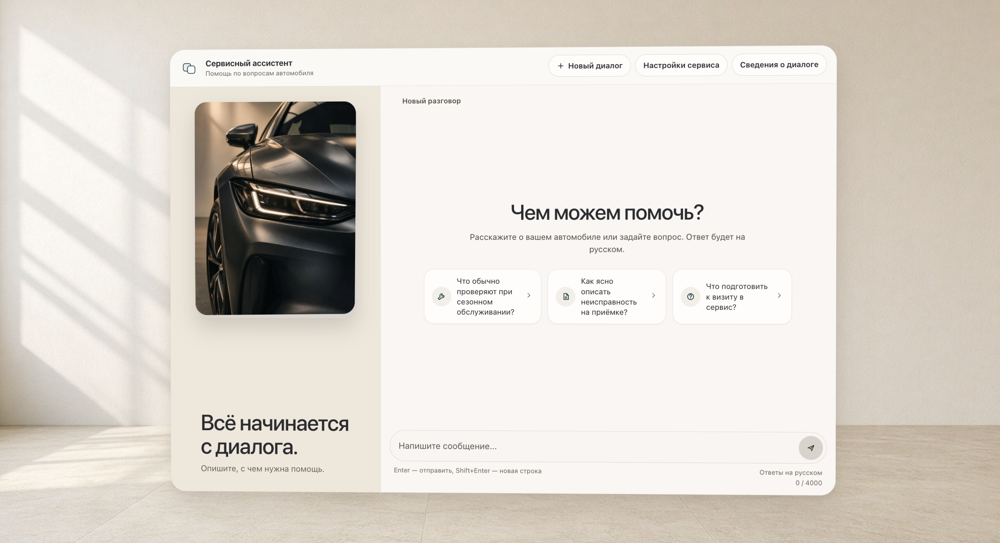
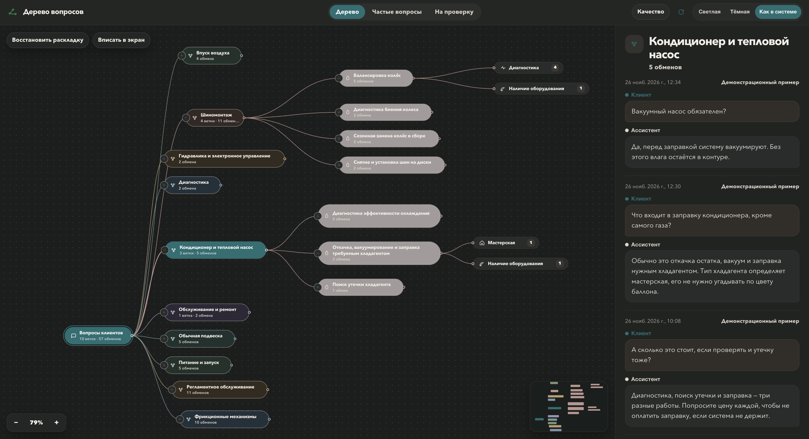

# Разработка локального голосового AI-бота

По запросу заказчика команда разработала текстовый веб-чат для автосервиса. Клиент описывает проблему с автомобилем и получает ответ на русском языке. В панели команды можно открыть вопрос клиента и ответ ассистента, выбрав соответствующую услугу в дереве вопросов.

[Карточка проекта в УрФУ TeamProject](https://teamproject.urfu.ru/#/75785144-aa9d-47ab-8de1-96977b72528c/about)



*Чат клиента. Можно написать сообщение или выбрать подсказку. Ответ приходит на русском языке.*

## Что может клиент и что видит команда

Клиент описывает неисправность или нужную работу своими словами. В одном разговоре сохраняются уже названные марка, модель, год, город и суть обращения, в том числе исправление. Если строка каталога подходит однозначно, ассистент называет работу. Название не означает, что услуга выполнена, что есть инструмент, цена или свободное окно. Ответ короткий, уточняющий вопрос — не больше одного. Сообщение, похожее на срочный случай, получает предупреждение: это не оценка безопасности поездки. Под ответом можно поставить оценку и отметить «решено». Оценка не меняет следующий ответ.

Язык страницы переключается на русский или турецкий. Текст ответа клиенту остаётся русским.

Цену, телефон, адрес и часы ассистент берёт только из локального JSON, путь к которому задан в `AUTOSERVICE_BUSINESS_FACTS`. Если файла нет, сумму он не называет и запись не создаёт. Позвонить в сервис или подобрать мастерскую по живому прайсу он не может.

Команда открывает панель дерева вопросов. На странице три вида: дерево, частые вопросы и разбор. Выбор услуги показывает справа переписку этой ветки: вопрос клиента и ответ ассистента. Кнопка «Качество» открывает отдельный разбор оценок. Это не правка ветки и не изменение следующего ответа. Кнопка «Скачать одобренные» запрашивает `GET /api/quality-review/export` и получает `approved-examples.jsonl`: только явно одобренный пример, если звёзды и отметка «решено» с тех пор не менялись. Идентификаторы разговора, телефоны, почта и ссылки из текста убираются.

Записи на снимке ниже — демонстрационные примеры. В панели переписки у них видна метка «Демонстрационный пример».



*Панель команды. Услуга выбирается в дереве, справа открываются вопрос клиента и ответ ассистента. Метка «Демонстрационный пример» остаётся на записи.*

## Как сообщение становится ответом и записью

Обычный запуск поднимает локальные службы и не вызывает YandexGPT. Запускатель выставляет `AUTOSERVICE_MODEL_URL` на локальный адрес извлечения. Клиент YandexGPT в каталоге `connector/` нужен только если чат запущен без этого адреса и заданы ключ и каталог Yandex Cloud. Файл `.env` в репозиторий не входит.

Сообщение приходит в чат. Программа читает реплику, ищет подходящие строки каталога в локальном PostgreSQL и собирает короткий контекст: автомобиль, текущая работа, несколько строк каталога и последние реплики. Поиск сравнивает отличительные слова с названием и псевдонимами. Строка называется клиенту только при счёте не ниже 3 и отрыве не меньше 2 от следующей. Похожие обучающие диалоги задают форму ответа и в текст не копируются. Сорок диалогов из `benchmark/dev_dialogue_ids.json` в поиск не входят.

Пока `AUTOSERVICE_REPLY_WRITER` не равен `off`, содержательный ответ пишет базовая Mica v0.1 4B через `llama-server`: локальный адрес `http://127.0.0.1:8768/v1/chat/completions`. В теле запроса масштаб загруженного LoRA равен нулю, поэтому для текста используется базовая модель, а не обученный классификатор. В ответе API это подписано как `Mica 4B base (local llama.cpp)`. Проверка в `webapp/reply_writer.py` отбрасывает ответ, если модель недоступна, не успела, ответила не по-русски или добавила цену, телефон, время, запись, «у нас» либо выполненные работы без опоры на переданные факты. Тогда клиент видит запасную формулировку из фактов этого разговора и каталога, без нового вызова модели.

Короткое приветствие, краткое подтверждение, сообщение не про автомобиль, первое срочное предупреждение, короткий ответ на уже заданный вопрос и согласие на ранее предложенный черновик, адрес или визит пишущая модель не обрабатывает. Их собирает та же программа.

Qwen3.5 0.8B в обычном пути текст клиенту не пишет. Он включается вместе с классификацией, если задать `AUTOSERVICE_REPLY_WRITER=off`. Тогда обращение, которому нужно извлечение, уходит на локальный адрес `http://127.0.0.1:8767/extract`. Mica с обученным LoRA предлагает строки каталога, Qwen3.5 0.8B с обученным LoRA заполняет слоты. Политика диалога готовит структуру, а клиент снова видит программную формулировку. В этом режиме модель подписана как `Mica + Qwen local preview`. Отдельный черновик `POST /draft` чат не вызывает.

Показанный ответ записывается в PostgreSQL: сообщение клиента, текст ответа и услуга, если она определена. Запись не мешает ответу: если база недоступна, клиент всё равно видит текст, а в журнал уходит ошибка записи. Панель читает сохранённые обмены и группирует их по услуге. Повтор того же `request_id` в том же разговоре с тем же текстом возвращает уже сохранённый ответ.

PostgreSQL хранит каталог, поиск и переписку. Текст ответа база не генерирует. Рабочая база — локальный PostgreSQL 18, а не размещённый проект Supabase. Каталог `supabase/` содержит SQL-миграции. Команда `supabase start` для этого приложения не нужна.

## Локальный запуск

Нужны Python 3.12, `curl`, `llama-server` и PostgreSQL 18. В метаданных пакета указан Python 3.10 и новее; локальные модели проверялись на 3.12. Колесо PyTorch из `local_models/requirements.txt` не рассчитано на произвольный более новый Python. На Apple Silicon ставится сборка Homebrew с Metal: `brew install llama.cpp`. Код по умолчанию вызывает `/opt/homebrew/opt/postgresql@18/bin/psql` и соседний `pg_ctl`. Другой путь задаётся через `AUTOSERVICE_PSQL` и `AUTOSERVICE_PG_CTL`. На Apple Silicon Mica идёт через Metal, если `AUTOSERVICE_MICA_NGL` не переопределён. Qwen на пути извлечения использует MPS. Вне Apple Silicon запускатель ставит слои Mica в `0`.

```bash
git clone https://github.com/bekirs01/local-voice-ai-bot.git
cd local-voice-ai-bot
python3.12 -m venv .venv
source .venv/bin/activate
python -m pip install --upgrade pip
python -m pip install -r local_models/requirements.txt
```

Необязательный клиент YandexGPT и его тесты: `python -m pip install -e ".[dev]"`. Для локального чата этот шаг не нужен. Ключи, если они нужны клиенту Yandex, копируются только локально: `cp .env.example .env`.

Веса базовых моделей в Git не хранятся. Запуск чата их сам не скачивает. Один раз из корня репозитория:

```bash
python local_models/setup_models.py
```

Скрипт берёт публичные файлы, только если локальной копии нет или она не совпадает с зафиксированным размером либо SHA-256:

- Mica Q4: ревизия `ca36594cc2067c7252704f9f304cc10ef11c7c5c`, файл `mica-v0.1-4b-Q4_K_M.gguf`, 3 066 384 768 байт.
- Qwen3.5 0.8B: ревизия `2fc06364715b967f1860aea9cf38778875588b17`, файл `model.safetensors-00001-of-00001.safetensors`, SHA-256 `04b1c301231dd422b8860db31311ab2721511346a32cb1e079c4c4e5f1fe4696`.

Файлы ложатся в `local_models/models/mica/` и `local_models/qwen_project/models/qwen3.5-0.8b/`. В репозитории уже лежат адаптеры `local_models/mica_baseline_lora.gguf` и `local_models/qwen_project/trained_model/qwen3.5-0.8b-lora/`.

Кластер PostgreSQL создаётся один раз и остаётся на машине. Запускатель его не создаёт: он поднимает уже существующий каталог `.local_pg/data`, если сокет, порт и имя базы не переопределены. Каталог `.local_pg/` в Git не входит.

```bash
export PATH="/opt/homebrew/opt/postgresql@18/bin:$PATH"
initdb -D .local_pg/data -U autoservice_owner --auth=trust --encoding=UTF8 --locale=C
mkdir -p /tmp/autoservice-pg
chmod 700 /tmp/autoservice-pg
pg_ctl -D .local_pg/data -l .local_pg/postgres.log \
  -o "-p 54332 -k /tmp/autoservice-pg -c listen_addresses=" start
createdb -h /tmp/autoservice-pg -p 54332 -U autoservice_owner autoservice_assistant
for file in supabase/migrations/*.sql; do
  psql -h /tmp/autoservice-pg -p 54332 -U autoservice_owner \
    -d autoservice_assistant -v ON_ERROR_STOP=1 -f "$file"
done
python data_layer/import_dataset.py --apply
```

Сокет `/tmp/autoservice-pg`, порт `54332`, база `autoservice_assistant`. TCP закрыт: клиент подключается через сокет. Чтение каталога идёт от роли `autoservice_runtime` через представления `autoservice_api`. Повторный импорт обновляет те же идентификаторы. Набор в `autoservice_dataset/` синтетический: 1000 обучающих и 200 тестовых диалогов, версия `1.0-synthetic`. Подробности набора — в [autoservice_dataset/README.md](autoservice_dataset/README.md). Схема дерева работ — в [docs/auto-question-tree/README.md](docs/auto-question-tree/README.md), справочник работ — в [docs/auto-work-types.md](docs/auto-work-types.md).

Из корня, с активированным виртуальным окружением и уже скачанными весами:

```bash
python local_models/start_preview.py
```

Команда проверяет веса и `llama-server`, при необходимости стартует локальный кластер и поднимает только те службы, которые ещё не отвечают на свою проверку: Mica на порту 8768, извлечение Qwen на порту 8767, страница на порту 8766. Если порт занят чужим процессом, запускатель останавливается и не завершает этот процесс. Ctrl+C останавливает только процессы, которые стартовала эта команда.

- Чат, локальный адрес: [http://127.0.0.1:8766](http://127.0.0.1:8766). Проверка сервера: `GET /api/health`.
- Панель команды, локальный адрес: [http://127.0.0.1:8766/team/question-tree.html](http://127.0.0.1:8766/team/question-tree.html).
- Извлечение, локальный адрес: `GET http://127.0.0.1:8767/health`.

В чате кнопка «Сведения о диалоге» открывает панель разработчика. В ней ссылка «Дерево вопросов». Для уже сохранённого обмена есть «Показать в дереве».

| Переменная | По умолчанию | Назначение |
| --- | --- | --- |
| `AUTOSERVICE_UI_PORT` | `8766` | Страница чата |
| `AUTOSERVICE_EXTRACT_PORT` | `8767` | Извлечение Mica и Qwen |
| `AUTOSERVICE_MICA_PORT` | `8768` | `llama-server` |
| `AUTOSERVICE_MICA_URL` | `http://127.0.0.1:8768/completion` | Запросы извлечения к Mica |
| `AUTOSERVICE_REPLY_WRITER` | включён | `off` переключает чат на извлечение слотов |
| `AUTOSERVICE_WRITER_URL` | `http://127.0.0.1:8768/v1/chat/completions` | Адрес пишущей модели |
| `AUTOSERVICE_BUSINESS_FACTS` | пусто | JSON с проверенными ценами и контактами |
| `AUTOSERVICE_LOCAL_PGSOCKET` | `/tmp/autoservice-pg` | Сокет PostgreSQL |
| `AUTOSERVICE_LOCAL_PGPORT` | `54332` | Порт PostgreSQL |
| `AUTOSERVICE_LOCAL_PGDATABASE` | `autoservice_assistant` | Имя базы |

Службы слушают `127.0.0.1`. Если сокет, порт или имя базы переопределены, запускатель свой кластер не стартует. Другой порт страницы: `AUTOSERVICE_UI_PORT=8769 python local_models/start_preview.py`.

Каталог `benchmark/results/` в Git не входит: локальный прогон может сохранить тексты ответов и идентификаторы машины.
