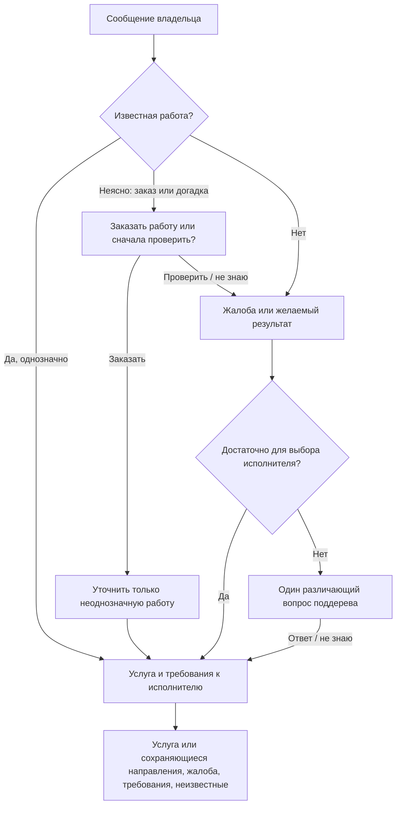

# Дерево вопросов для подбора автомастерской

Дата: 25 октября 2026 года. Статус: первая версия для ручной проверки.

Основание: [план](../auto-question-tree-plan.md) и [справочник работ](../auto-work-types.md). В каталоге представлены все 394 работы справочника. Граф определяет услугу и требования к исполнителю; наличие подходящих реальных мастерских ещё нужно проверять по конкретным филиалам.

## Что читать

| Файл | Содержание |
|---|---|
| [tree.json](tree.json) | Общий вход, порядок маршрутизации, общие вопросы и завершения |
| [mechanical.md](mechanical.md) / [JSON](mechanical.json) | Двигатель, трансмиссия, ходовая, тормоза, колёса и электрика: разделы 01–13 |
| [equipment.md](equipment.md) / [JSON](equipment.json) | Свет, климат, электромобили, ГБО, кузов, оборудование и смежные услуги: 14–25 |
| [slots.md](slots.md) / [JSON](slots.json) | Общие слоты, происхождение сведений, история исправлений и состав результата |
| [catalog.json](catalog.json) | Идентификаторы, точные названия, бытовые названия, необходимые сведения и возможности исполнителя |
| [coverage.md](coverage.md) | Каждая работа справочника: прямой запрос и бытовой вход |
| [checks.md](checks.md) | Сквозные диалоги, ограничения и результаты проверки связности |

JSON — структурированная спецификация. Условия в `applies_when` и правила извлечения сведений записаны текстом: перед запуском бота им понадобятся реализация и проверка на реальных сообщениях. Связи с каталогом задаются через `service_ids`; `source_titles` оставлены для сверки.

## Общий ход разговора

Это схема принятия решения, а не обязательная анкета. Уже известный ответ пропускает вопрос. После любой новой реплики снова применяются входные правила: одно сообщение может одновременно назвать услугу, автомобиль, событие и текущее состояние.

1. **Прямой заказ.** «Замените свечи» сразу выбирает работу. Если человек говорит «наверное, свечи: плохо заводится», сохраняется предположение и выбирается диагностика запуска. Вопрос о намерении возникает только если заказ нельзя отличить от предположения.
2. **Понятная жалоба.** «Кондиционер не холодит» сразу выбирает диагностику эффективности охлаждения. Сведения о хладагенте проверяет исполнитель; спрашивать владельца о них ради первого выбора не нужно.
3. **Неясная жалоба.** «С ходовой что-то» вызывает один вопрос о заметном проявлении: торможение, руль, неровности, колесо или неизвестный шум. «Не знаю» ведёт к общему осмотру по доступному описанию; поиск шума выбирается, если шум действительно заявлен.
4. **Желаемый результат.** «Проверьте перед покупкой» соответствует готовой услуге. «Хочу что-то поставить для перевозки вещей» требует уточнить задачу; конкретное оснащение выбирается после проверки совместимости.
5. **Несколько задач.** «Скрипят тормоза и не работает кондиционер» даёт два результата. Если один сервис не подтвердил обе компетенции, сохраняются два направления подбора. Выбор первой задачи не удаляет вторую.

## Входы поддеревьев

Перечень ниже нужен маршрутизатору. Пользователю не показывается меню из 25 разделов. Если смысл сообщения не удаётся уверенно сопоставить, общий `unknown` просит описать наблюдение своими словами один раз, затем завершает общим осмотром с сохранением неопределённости.

| По словам владельца | Вход / результат |
|---|---|
| Не заводится, глохнет, не тянет, после лужи/заправки | `mechanical.result.engine`; текущее состояние уточняется только для формата помощи |
| Перегревается, не прогревается двигатель | `mechanical.result.cooling` |
| Уходит масло, видна течь, неизвестный шум | `mechanical.result.oil` / `leak` / `noise` |
| Плохо переключаются передачи | `mechanical.gear`; известный тип пропускает вопрос |
| Тормоза, руль, подвеска, колёса | `mechanical.chassis`; известное проявление сразу выбирает соответствующий результат |
| Аккумулятор разряжается, пропадает электрика | `mechanical.result.power` / `electric` |
| Свет, дворники, зеркала, обогрев стекла | `equipment.visibility` |
| В салоне холодно/жарко, не дует | `equipment.climate` |
| Зарядка электромобиля, запас хода, предупреждение гибрида | `equipment.hv`; компетенция для фактического исполнения машины |
| Газовое оборудование | `equipment.gas` |
| Вмятина, ДТП, коррозия, дверь, вода в салоне | `equipment.body`; при нескольких последствиях сохранить другие направления |
| Стекло повреждено или течёт | `equipment.glass` |
| Подушки, ремни, парковочные камеры, помощники водителя | `equipment.safety` |
| Ключ, доступ, сиденья, окно, мультимедиа | `equipment.comfort` |
| Установить оборудование или решить задачу оснащением | `equipment.equipment` |
| Очистить, защитить, восстановить внешний вид | `equipment.care` |
| Нужен выезд, перевозка, помощь на месте | `equipment.assistance` |
| Прицеп, гидроборт, холодильник фургона, другое спецоборудование | `equipment.commercial`; проверить охват проекта |
| Точная работа любого раздела, ТО, проверка перед покупкой | Общий `direct`, без обхода поддеревьев |

При пересечении направлений тип машины меняет требования к исполнителю, а не доказывает неисправность: отказ запуска гибрида не означает поломку тяговой батареи. Неясный тип сохраняется существенным неизвестным до проверки применимости сервиса.

## Когда разговор заканчивается

Остановка наступает, когда известна работа, выбрана достаточная диагностика или оставшиеся различия устанавливаются при осмотре одним подходящим исполнителем. Сохраняющиеся направления могут быть альтернативами, а не заказом всех перечисленных работ: это явно указывается в результате.

В выдаче нужны четыре части:

- Услуга либо сохраняющиеся направления с пометкой «диагностика» для жалобы.
- Требования к мастерской: компетенция, нужное оснащение, применимость к автомобилю и формат помощи.
- Жалоба словами владельца; событие, прошлое и текущее состояние отдельно.
- Существенные неизвестные, которые нужно передать исполнителю.

Например, после лужи: «Проверка по жалобе на потерю тяги и остановку двигателя после воды. Нужен сервис с диагностикой запуска/работы двигателя и электрики. Сейчас, по сообщению владельца, машина снова завелась. Причина не установлена; прошлый отказ сохранён». Это завершение не назначает ремонт клемм и не предлагает ждать высыхания.

## Сведения и исправления

У каждого наблюдения сохраняются исходная фраза и ссылка на сообщение. Гипотеза владельца, чужое заключение и вывод маршрутизатора хранятся раздельно. Отсутствие упоминания не равно отсутствию признака; `unknown` не равно «нет».

«Не заводилась, теперь завелась» — изменение состояния во времени. «Я ошибся: не двигатель перегревается, а печка плохо греет» — исправление с пересчётом ветки. Действительно противоречивые сведения сохраняются с отметкой конфликта; уточнение нужно только если конфликт меняет выбор исполнителя. История и другие жалобы остаются.

Вопросы о марке, типе коробки, исполнении силовой установки и формате выполнения задаются по применимости. Поля `required_information` каталога описывают сведения для проверки совместимости у сервиса, а не обязательные ответы владельца: неизвестное допускается. Общие слоты и соответствия локальных названий указаны в `tree.json`.

## Проверка и следующие уточнения

Сначала сверены законченные ветки запуска, ходовой и климата, затем исправлены общие слишком узкие переходы. Полный каталог покрыт прямыми запросами; бытовые входы охватывают основные направления. Ручные диалоги приведены рядом с поддеревьями и в `checks.md`; это проверка заданных примеров, а не доказательство минимальной длины всех разговоров.

Спорные предметные связи перечислены в `disputed_transitions` файла `mechanical.json` и `expert_review` файла `equipment.json`. Отдельной проверки специалистом требуют границы первичной диагностики, ближайшие действия при запахе газа/попадании воды в электромобиль и применимость специальных работ. До такой проверки дерево служит проектом подбора услуг; правила срочности и безопасной транспортировки не заменяются догадками из названия жалобы.
